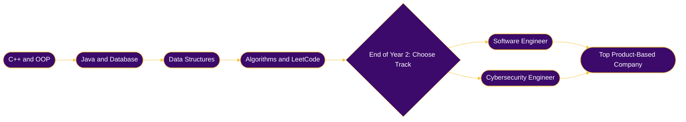
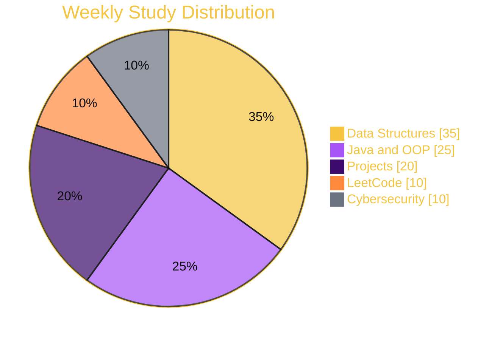

```text
╔════════════════════════════════════════════════════════╗
║         W E L C O M E   T O   M Y   W O R L D          ║
╚════════════════════════════════════════════════════════╝
```

<!-- ═══════════ HEADER ═══════════ -->
<p align="center">
  
</p>

<p align="center">
  <a href="https://github.com/ShorifUddin64">
    
  </a>
</p>

<p align="center">
  
  
  
</p>

<p align="center">
  <a href="https://linkedin.com/in/shorifuddin64"></a>
  <a href="https://leetcode.com/Shorifuddin64"></a>
  <a href="mailto:shorifuddin64662@gmail.com"></a>
  <a href="https://www.facebook.com/share/1DUEWBjo3P/"></a>
</p>

<!-- ═══════════ JUMP MENU ═══════════ -->
<p align="center">
  <a href="#about"></a>
  <a href="#focus"></a>
  <a href="#tech"></a>
  <a href="#projects"></a>
  <a href="#goals"></a>
  <a href="#stats"></a>
  <a href="#connect"></a>
</p>


<a id="about"></a>
## 👑 About Me

<table align="center">
<tr>
<td align="center" valign="middle" width="35%">


<br><br>

**MD. Shorif Uddin**<br>
<sub>CSE @ AIUB • Jamalpur, Bangladesh</sub>

</td>
<td valign="middle" width="65%">

```text
╭─[ shorif@aiub ]──────────────────────────
│
│  $ whoami
│  > MD. Shorif Uddin — CSE student @ AIUB
│
│  $ cat goals.txt
│  > Software Engineer @ Google | Meta
│    Microsoft | Amazon
│  > Cybersecurity track — decide at
│    end of Year 2
│
│  $ ./status --today
│  > Solving problems...
│  > Learning Data Structures...
│  > Building projects...
│
│  $ echo $MOTTO
│  > Consistency > Motivation
│
╰──────────────────────────────────────────
```

</td>
</tr>
</table>

```cpp
class ShorifUddin {
public:
    string university   = "AIUB — B.Sc. in CSE";
    string primaryGoal  = "Software Engineer @ top product-based companies";
    string secondTrack  = "Cybersecurity (final decision: end of Year 2)";
    string passion      = "Problem Solving • OOP • Secure Systems";

    vector<string> completedProjects = {
        "C++ OOP Core Projects",
        "Java Application Suite"
    };

    vector<string> planningProjects = {
        "Bill Management System",
        "Database Security Project"
    };

    string motto = "Consistency > Motivation";
};
```

<table align="center">
<tr>
<td width="50%" valign="top">

### 🔭 Currently
- 📚 Mastering **Data Structures** in C++
- 🧩 Solving problems daily on **LeetCode**
- ☕ Deepening **Java OOP** & **Database** fundamentals
- 🛡️ Exploring **Cybersecurity** basics

</td>
<td width="50%" valign="top">

### 🎯 Next Up
- 🚀 Build the **Bill Management System**
- 🔐 Start the **Database Security Project**
- 🧠 Algorithms & Problem-Solving patterns
- 🏆 Become interview-ready for top product companies

</td>
</tr>
</table>


<a id="focus"></a>
## 🎯 Focus Areas

<table align="center">
<tr>
<td align="center" width="33%">
<h3>🧠 Problem Solving</h3>
<sub>Data Structures<br>Algorithms<br>LeetCode Practice</sub>
</td>
<td align="center" width="33%">
<h3>🏗️ Software Engineering</h3>
<sub>C++ & Java OOP<br>Clean Code<br>Real Projects</sub>
</td>
<td align="center" width="33%">
<h3>🛡️ Cybersecurity</h3>
<sub>Secure Databases<br>Linux & Networking<br>Ethical Hacking Basics</sub>
</td>
</tr>
</table>


<a id="tech"></a>
## 🛠️ Tech Arsenal

<table align="center">
<tr>
<td align="center"><b>💻 Languages</b></td>
<td align="center"><b>🌐 Web</b></td>
<td align="center"><b>🧰 Tools</b></td>
<td align="center"><b>🗄️ Database</b></td>
</tr>
<tr>
<td align="center"></td>
<td align="center"></td>
<td align="center"></td>
<td align="center"></td>
</tr>
</table>

<p align="center">
  
  
  
</p>


<a id="projects"></a>
## 📁 Featured Projects

<table align="center">
<tr>
<td align="center" width="33%" valign="top">
<h3>🚀 All Projects</h3>
<sub>আমার সব project এক জায়গায়</sub><br><br>
<a href="https://github.com/Shorifuddin64/-ALL-PROJECTS"></a><br>

</td>
<td align="center" width="33%" valign="top">
<h3>☕ Java Projects</h3>
<sub>Java OOP Application Suite</sub><br><br>
<a href="https://github.com/Shorifuddin64/JAVA"></a><br>

</td>
<td align="center" width="33%" valign="top">
<h3>💻 C++ OOP</h3>
<sub>OOP Core Concepts in C++</sub><br><br>
<a href="https://github.com/Shorifuddin64/OOP_Basic-Concepts-in-c-"></a><br>

</td>
</tr>
</table>


## 📈 Skill Progress

<table align="center">
<tr><td><b>C++ & OOP</b></td><td>🟨🟨🟨🟨🟨🟨🟨⬛⬛⬛</td><td><b>70%</b></td></tr>
<tr><td><b>Java (OOP)</b></td><td>🟨🟨🟨🟨🟨🟨⬛⬛⬛⬛</td><td><b>60%</b></td></tr>
<tr><td><b>Database Basics</b></td><td>🟨🟨🟨🟨🟨⬛⬛⬛⬛⬛</td><td><b>50%</b></td></tr>
<tr><td><b>Data Structures</b></td><td>🟨🟨🟨⬛⬛⬛⬛⬛⬛⬛</td><td><b>30%</b></td></tr>
<tr><td><b>Algorithms</b></td><td>🟨⬛⬛⬛⬛⬛⬛⬛⬛⬛</td><td><b>15%</b></td></tr>
<tr><td><b>Cybersecurity</b></td><td>🟨⬛⬛⬛⬛⬛⬛⬛⬛⬛</td><td><b>10%</b></td></tr>
</table>


<a id="goals"></a>
## ✅ Goals Checklist

- [x] Learn **C++ OOP** fundamentals
- [x] Learn **Java OOP** fundamentals
- [ ] Master **Data Structures** (Array, Linked List, Stack, Queue, Tree, Graph)
- [ ] Solve **100+ LeetCode** problems
- [ ] Build the **Bill Management System**
- [ ] Build the **Database Security Project**
- [ ] Decide final track: **SWE** or **Cybersecurity** (end of Year 2)
- [ ] Become **job-ready** for top product-based companies


## 🗺️ My 4-Year Roadmap



## ⏱️ My Weekly Time Split




<a id="stats"></a>
## 📊 Live Stats

<p align="center">
  
</p>

### 🧠 LeetCode Journey

<p align="center">
  
</p>


## 🎲 Fun Facts

<details>
<summary><b>👉 Click to open</b></summary>

- 🎓 First-year CSE student at **AIUB**
- 🌱 Started with **C++**, then moved to **Java OOP** and **Databases**
- 🧩 Believes in solving **one problem every day**
- 🛡️ Still deciding between **SWE** and **Cybersecurity**, and enjoying both
- 🎮 Loves a quick retro game break after a long study session

</details>

<p align="center">
  <a href="https://www.retrogames.cc/"></a>
</p>


<a id="connect"></a>
## 🤝 Let's Connect

<table align="center">
<tr>
<td align="center" width="50%" valign="top">
<h3>💬 Open To</h3>
<sub>Study partners<br>Project collaboration<br>Problem-solving discussions<br>Cybersecurity learning groups</sub>
</td>
<td align="center" width="50%" valign="top">
<h3>📬 Reach Me</h3>
<sub>Email: shorifuddin64662@gmail.com<br>LinkedIn: linkedin.com/in/shorifuddin64<br>LeetCode: leetcode.com/Shorifuddin64</sub>
</td>
</tr>
</table>

> ### 💬 *"Consistency > Motivation."*

<!-- ═══════════ FOOTER ═══════════ -->
<p align="center">
  
</p>

```text
╔════════════════════════════════════════════════════════╗
║       THANKS FOR VISITING  •  KEEP LEARNING DAILY      ║
╚════════════════════════════════════════════════════════╝
```
